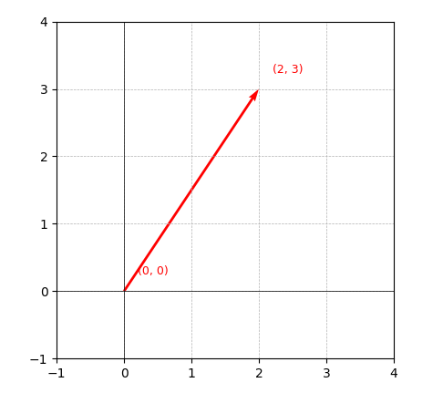
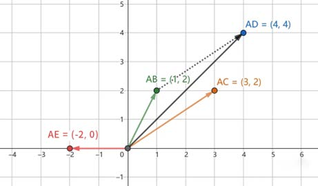
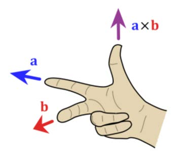

# 一、人工智能中的线性代数

## （一）标量  

标量（Scalar）是==只有大小，没有方向的量==。他是一个单独的数，可以是整数、实数或复数。比如温度、时间、质量等都是标量。

 在数学计算中，标量可以进行常规的算术运算，如加、减、乘、除等。 

## （二）向量  

### 1. 表现形式  

向量（Vector）是==既有大小又有方向的量==，可以形象化的表示为带箭头的线段，箭头所指代表向量的方 向，线段长度代表向量的大小。在数学表示上，==向量通常用粗体字母或字母上加箭头表示==，如 $\vec{a}$ 或 **a**。 

在空间直角坐标系中，也可以把向量以数对的形式表示，比如在平面直角坐标系中（2，3）就是一个向量。

### 2. 向量的加减法

当两个向量进行加减操作时，两个向量==必须是同维向量==，即它们==必须有相同数量的分量==，例如在二维空间的向量都有两个分量，在三维空间中，各自有三个分量。

当向量以数学的形式表示时，对于向量 $\vec{a}=(a_1,a_2,...,a_n)$和 $\vec{b}=(b_1,b_2,...,b_n)$来说，它们的和就是各自对应位置的分量的和，即 $\vec{a}+\vec{b}=(a_1+b_1,a_2+b_2,...,a_n+b_n)$，它们的差就是各自对应位置的分量的差，即$\vec{a}-\vec{b}=(a_1-b_1,a_2-b_2,...,a_n-b_n)$。

如果放在平面直角坐标系中，比如有两个向量$\vec{AB}=(1,2)、\vec{AC}=(3,2)$，那么$\vec{AB}+\vec{AC}=(1+3,2+2)=(4,4)$，也就是$\vec{AD}$；$\vec{AB}-\vec{AC}=(1-3,2-2)=(-2,0)$，也就是$\vec{AE}$。

### 3. 向量的乘法

向量的乘法分两种，<u>第一种是使用标量乘以向量</u>，也就是向量的**数乘**，<u>另一种是向量乘以向量</u>，根据计算结果分**内积和外积**。

#### （1）向量的数乘

**数乘**就是使用一个==标量乘以向量==，其核心本质就是对向量的大小和方向进行改变，比如$\vec{a}=(1,1)$，使用标量2和该向量进行数乘时，得到的结果是（2，2），如果使用标量-2和该向量进行数乘时，得到的结果就是（-2，-2）。

#### （2）向量的内积

当**两个向量相乘的结果是标量**时，又叫做向量的==内积、点积==，使用==$\cdot$==作为运算符。

比如向量$\vec{a}=(2,3)$，向量$\vec{b}=(4,-1)$，那么这两个向量内积（点积）的结果就是$\vec{a}\cdot\vec{b}=2\times4+3\times(-1)=8-3=5$。

在这个例子中，先将**两个向量对应坐标相乘，然后再把乘积相加**，得到的结果就是这两个向量的内积。

计算==两个向量之间的夹角的公式==为：
$$
\cos \theta = \frac{\vec{a} \cdot \vec{b}}{|\vec{a}| |\vec{b}|} = \frac{x_1 x_2 + y_1 y_2}{\sqrt{x_1^2 + y_1^2} \sqrt{x_2^2 + y_2^2}}
$$

#### （3）向量的外积

当**两个向量相乘的结果是向量**时，叫做向量的==外积==，使用==×==作为运算符，所以也叫做==叉积==。

需要注意的是，向量的外积运算只对三维空间中的向量有定义，二维空间中没有严格意义上的外积定义。

两个向量做外积相乘时，得到的新的向量的方向垂直于相乘的两个向量组成的平面，大小与相乘的两个向量组成的平行四边形的面积的值相等。

设有两个三位向量 $\vec{A} = (A_x, A_y, A_z)$ 和 $\vec{B} = (B_x, B_y, B_z)$，它们的外积 $\vec{A} \times \vec{B}$ 是一个**新向量**，其计算方式如下：
$$
\vec{A} \times \vec{B} =
\begin{vmatrix}
\vec{i} & \vec{j} & \vec{k} \\
A_x & A_y & A_z \\
B_x & B_y & B_z
\end{vmatrix}
$$
其中，$\vec{i}, \vec{j}$ 和 $\vec{k}$ 分别是 x、y 和 z 轴的单位向量。

比如向量 $\vec{a} = (2, 3, 0)$，向量 $\vec{b} = (4, -1, 0)$，那么其外积的结果为：
$$
\vec{a} \times \vec{b} = (3 \times 0 - 0 \times (-1), 0 \times 4 - 2 \times 0, 2 \times (-1) - 3 \times 4) = (0, 0, -14)
$$

## （三）矩阵

矩阵（Matrix）**矩阵是一个由数字组成的二维数组**，通常用大写字母表示，如 A。矩阵的元素可以是标量、矩阵的行数和列数分别称为矩阵的维度，一个 $m \times n$ 的矩阵有 $m$ 行和 $n$ 列，可以表示为：

$$
A = 
\begin{pmatrix}
a_{11} & a_{12} & \cdots & a_{1n} \\
a_{21} & a_{22} & \cdots & a_{2n} \\
\vdots & \vdots & \ddots & \vdots \\
a_{m1} & a_{m2} & \cdots & a_{mn}
\end{pmatrix}
$$

其中这 $m \times n$ 个数称为矩阵 A 的元素，$a_{ij}$ 称为矩阵 A 的第 $i$ 行第 $j$ 列元素，矩阵的每一行或每一列都可以理解为一个行向量或列向量。

### 1. 特殊类型的矩阵

- **行矩阵**：只有一行的矩阵称为行矩阵或行向量。

$$
\begin{bmatrix}
a_1 & a_2 & a_3 & \cdots & a_n
\end{bmatrix}
$$

- **列矩阵**：只有一列的矩阵称为列矩阵或列向量。

$$
\begin{bmatrix}
a_1 \\
a_2 \\
\vdots \\
a_n
\end{bmatrix}
$$

- **零矩阵**：元素都为0的矩阵称为零矩阵。

$$
\begin{bmatrix}
0 & 0 & 0 \\
0 & 0 & 0 \\
0 & 0 & 0
\end{bmatrix}
$$

- **方阵**：矩阵的行数与列数相等，即 $m = n$ 的矩阵，称为 $n$ 阶方阵。

$$
\begin{bmatrix}
1 & 2 & 3 \\
1 & 2 & 3 \\
1 & 2 & 3
\end{bmatrix}
$$

- **单位矩阵**：主对角线元素为 1，其余元素为 0 的方阵。

$$
\begin{bmatrix}
1 & 0 & 0 \\
0 & 1 & 0 \\
0 & 0 & 1
\end{bmatrix}
$$

- **同型矩阵**：两个矩阵 $A$ 和 $B$ 的行数与列数对应相等的矩阵称为同型矩阵。

$$
A = 
\begin{bmatrix}
1 & 2 & 3 \\
4 & 5 & 6 \\
7 & 8 & 9
\end{bmatrix}
$$

$$
B = 
\begin{bmatrix}
9 & 8 & 7 \\
6 & 5 & 4 \\
3 & 2 & 1
\end{bmatrix}
$$

### 2. 矩阵的加减法

做运算的两个矩阵 $A$ 和 $B$ 必须是==同型矩阵==，其计算结果就是**将两个矩阵的对应元素进行相加减得到一个新的同型矩阵**。

比如矩阵 $A$ 为：

$$
A = 
\begin{bmatrix}
1 & 2 & 3 \\
4 & 5 & 6 \\
7 & 8 & 9
\end{bmatrix}
$$

矩阵 $B$ 为：

$$
B = 
\begin{bmatrix}
9 & 8 & 7 \\
6 & 5 & 4 \\
3 & 2 & 1
\end{bmatrix}
$$

那么 $A + B$ 的结果为：

$$
A + B = 
\begin{bmatrix}
1 + 9 & 2 + 8 & 3 + 7 \\
4 + 6 & 5 + 5 & 6 + 4 \\
7 + 3 & 8 + 2 & 9 + 1
\end{bmatrix}
=
\begin{bmatrix}
10 & 10 & 10 \\
10 & 10 & 10 \\
10 & 10 & 10
\end{bmatrix}
$$

减法同样如此。

### 3. 矩阵的乘法

矩阵的乘法分为两种，分别是**常数与矩阵相乘**、**矩阵与矩阵相乘**。

#### （1）矩阵的数乘

常数与矩阵相乘又称为矩阵的数乘。**数乘是指一个矩阵的所有元素都乘以一个常数 $k$**，相当于将这个矩阵内的所有元素缩放了 $k$ 倍大小。

比如矩阵 $A$ 为：

$$
A = 
\begin{bmatrix}
1 & 2 & 3 \\
4 & 5 & 6 \\
7 & 8 & 9
\end{bmatrix}
$$

那么将其与常数 $2$ 相乘，得到的结果就是：

$$
2 \times A = 
\begin{bmatrix}
2 & 4 & 6 \\
8 & 10 & 12 \\
14 & 16 & 18
\end{bmatrix}
$$
#### （2）⭐矩阵的内积

矩阵之间的乘法也叫做矩阵的点积、内积，是矩阵运算中的核心操作之一，其进行的前提条件是==第一个矩阵的**列数**必须等于第二个矩阵的**行数**==。当满足这一条件时，矩阵乘法的**结果将是一个新的矩阵**，其==行数等于第一个矩阵的行数，列数等于第二个矩阵的列数==。

即 $A_{mn} \times B_{np} = C_{mp}$。

比如矩阵 $A$ 为：

$$
A = 
\begin{bmatrix}
9 \\
6 \\
3 \\
\end{bmatrix}
$$

矩阵 $B$ 为：

$$
B = 
\begin{bmatrix}
1 & 2 & 3
\end{bmatrix}
$$

那么两个矩阵相乘的结果为：

$$
A \times B = 
\begin{bmatrix}
9 \times 1 & 9 \times 2 & 9 \times 3 \\
6 \times 1 & 6 \times 2 & 6 \times 3 \\
3 \times 1 & 3 \times 2 & 3 \times 3
\end{bmatrix}
=
\begin{bmatrix}
9 & 18 & 27 \\
6 & 12 & 18 \\
3 & 6 & 9
\end{bmatrix}
$$

需要注意的是：**矩阵的乘法一般不满足交换律**，即 $AB$ 与 $BA$ 的结果大概率是不同的，甚至在 $AB$ 可以相乘的情况下，$BA$ 不一定能够相乘。

总结：

> 数乘：一个矩阵的所有元素都乘以一个常数
>
> 内积：第一个矩阵的列数必须等于第二个矩阵的行数；结果是一个新矩阵，其行数等于第一个矩阵的行数，列数等于第二个矩阵的列数；左矩阵第i行与右矩阵第j列对应元素相乘后求和
>
> 矩阵的乘法一般不满足交换律

#### （3）矩阵的转置

指将矩阵的==行和列互换==得到的新矩阵。设矩阵 $A$ 是 $m$ 行 $n$ 列的矩阵，则矩阵 $A$ 的转置矩阵记作 $A^T$，它是一个 $n$ 行 $m$ 列的矩阵。

比如矩阵 $A$ 为：

$$
A = 
\begin{bmatrix}
1 & 2 \\
3 & 4 \\
5 & 6
\end{bmatrix}
$$

那么其转置矩阵就是：

$$
A^T = 
\begin{bmatrix}
1 & 3 & 5 \\
2 & 4 & 6
\end{bmatrix}
$$

### 总结

**标量就是一个单独的数，没有方向，只有大小。**

**向量是有方向和大小的量，可以表示为一组有序的标量。**

**矩阵是由行和列组成的二维数组，其中的每一行或每一列都可以看作一个行向量或列向量。**

## （四）张量

张量是可以具有==任意维度的数组==，<u>零维张量就是标量</u>，<u>一维张量就是向量</u>，<u>二维张量就是矩阵</u>，更高维的维度分别是图像的高度、宽度和颜色通道。

> [[[255, 255, 255]
> [255, 255, 255]
> [255, 255, 255]]
>
> [[255, 255, 255]
> [255, 255, 255]
> [255, 255, 255]]
>
> [[255, 255, 255]
> [255, 255, 255]
> [255, 255, 255]]]

在人工智能领域，尤其是深度学习中，张量扮演着核心角色，以下是张量在人工智能中的一些主要应用：

### 1. 数据表示

- **视频数据**：视频可以被看作是四维张量，增加了一个时间维度。
- **语音数据**：语音信号可以表示为一维张量，其中每个元素代表一个时间点的音频样本。
- **文本数据**：通过词嵌入技术，文本数据可以转换为二维张量，其中每一行代表一个单词的向量表示。

### 2. 神经网络参数：

- **权重和偏置**：神经网络的权重和偏置通常以张量的形式存储。

### 3. 运算和变换：

- **矩阵乘法**：在神经网络的全连接层中，输入张量与权重张量进行矩阵乘法。

- **卷积操作**：卷积神经网络（CNN）中的卷积操作是张量之间的运算，用于特征提取。

- **池化操作**：池化是在张量上执行的操作，用于降低数据的维度，同时保留重要信息。

### 4. 激活函数：

- **非线性变换**：激活函数应用于神经网络的每个神经元，对输入张量进行非线性变换。

### 5. 优化和反向传播：

- **梯度**：在训练过程中，损失函数关于网络参数的梯度也是以张量的形式存在。

- **参数更新**：优化算法（如梯度下降）使用梯度张量来更新网络的权重和偏置。

### 6. 并行计算：

- **GPU加速**：张量运算特别适合在 `GPU` 上进行并行计算，因为 `GPU` 专门为处理大规模并行张量运算而设计。

张量的这些应用使得深度学习框架（如`TensorFlow`、`PyTorch`、`PaddlePaddle`等）能够高效地构建、训练和部署复杂的深度学习模型。
